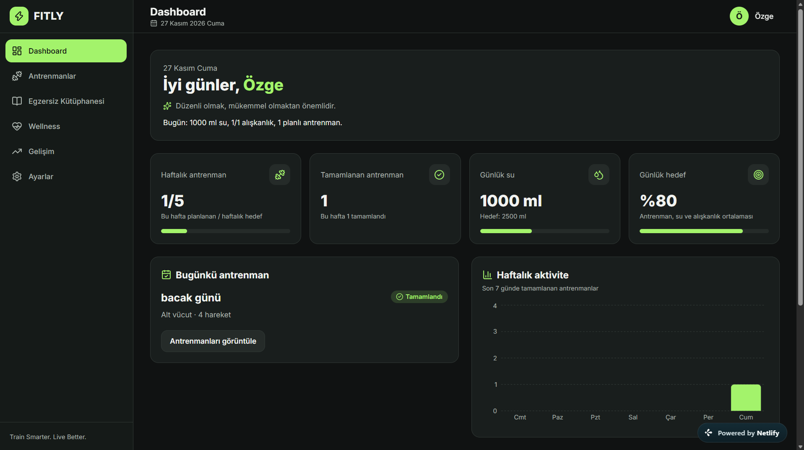
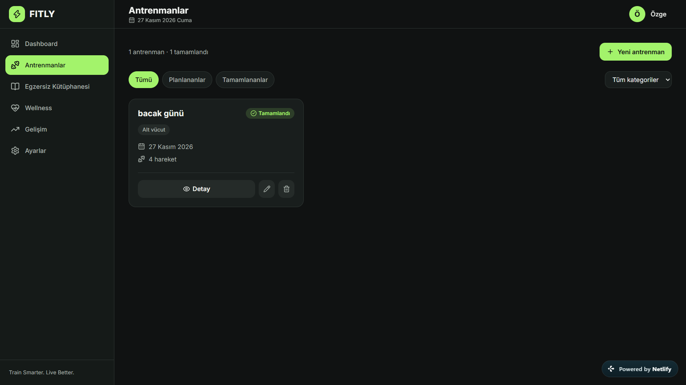
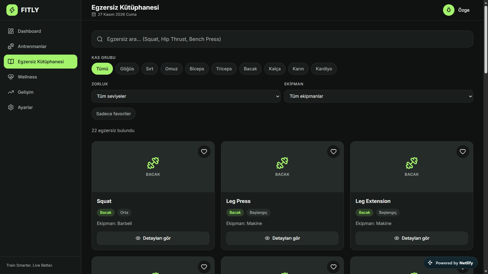
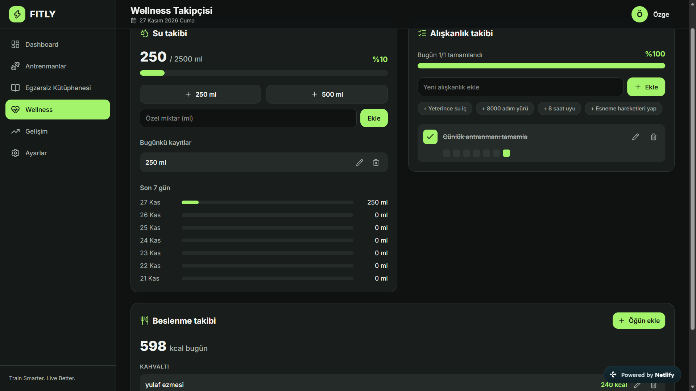
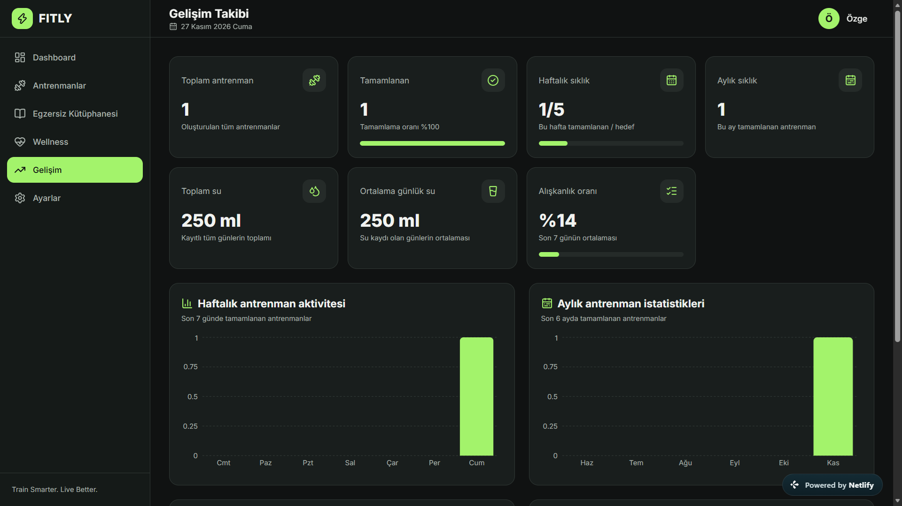
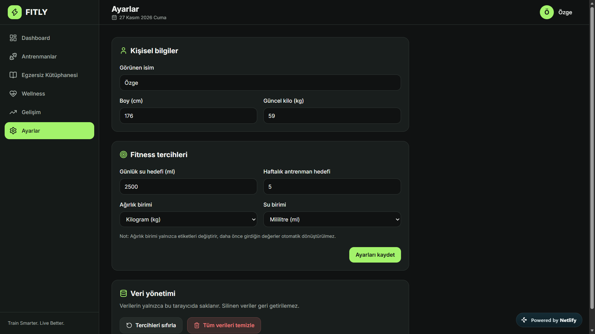

# FITLY – Kişisel Fitness ve Sağlıklı Yaşam Planlama Platformu

**Train Smarter. Live Better.**

FITLY; antrenman planlama, egzersiz öğrenme, su ve beslenme takibi, alışkanlık yönetimi ve gelişim analizini tek bir yerde sunan modern bir web uygulamasıdır.

## Canlı Demo ve Kaynak Kod

- 🌐 **Canlı site:** https://fitly-26qr.netlify.app
- 💻 **GitHub:** https://github.com/ozgplt23/fitly

## Ekran Görüntüleri

### Dashboard


### Antrenmanlar


### Egzersiz Kütüphanesi


### Wellness


### Gelişim


### Ayarlar


## Özellikler

- **Dashboard:** Günlük ve haftalık istatistikler, bugünkü antrenman, hedefler, son aktiviteler ve haftalık aktivite grafiği. Tüm değerler gerçek kayıtlardan hesaplanır.
- **Antrenman yönetimi (CRUD):** Antrenman ekleme, listeleme, düzenleme ve onaylı silme. Durum ve kategoriye göre filtreleme, antrenmanı tamamlama.
- **Egzersiz kütüphanesi:** 21 egzersiz; anlık arama, kas grubu, zorluk ve ekipman filtreleri; adım adım anlatım, sık yapılan hatalar, favoriler ve antrenmana ekleme.
- **Wellness:** Su takibi (250 ml, 500 ml, özel miktar), öğün ve kalori takibi, alışkanlık takibi ve geçmiş.
- **Gelişim:** İstatistik kartları, haftalık ve aylık antrenman grafikleri, su grafiği ve kilo takibi.
- **Ayarlar:** Kişisel bilgiler, su ve antrenman hedefi, birim tercihleri, tercihleri sıfırlama ve tüm verileri onaylı silme.
- **Responsive tasarım:** Masaüstü, tablet ve mobilde çalışır.
- **Erişilebilirlik:** Semantic HTML, klavye ile kullanım ve ARIA etiketleri.

## Kullanılan Teknolojiler

- React.js (fonksiyonel component'ler ve Hooks)
- Vite
- JavaScript (ES6+)
- Tailwind CSS
- React Router DOM
- Lucide React
- Recharts
- LocalStorage

## Kurulum

```bash
git clone https://github.com/ozgplt23/fitly.git
cd fitly
npm install
npm run dev
```

Üretim sürümü için:

```bash
npm run build
```

## Klasör Yapısı

```text
fitly/
├── public/
│   ├── _redirects
│   ├── images/exercises/
│   └── screenshots/
├── src/
│   ├── components/
│   │   ├── common/        Button, Modal, EmptyState
│   │   ├── dashboard/     StatCard, ActivityChart, TodayWorkout
│   │   ├── exercises/     Kart, arama, filtre, detay
│   │   ├── layout/        Sidebar, Navbar, MainLayout
│   │   ├── progress/      WeightTracker
│   │   ├── wellness/      Su, öğün, alışkanlık
│   │   └── workouts/      Kart, form, detay, egzersiz seçici
│   ├── data/              Egzersiz verisi, ayarlar, kategoriler
│   ├── hooks/             useLocalStorage
│   ├── pages/             Dashboard, Workouts, Exercises, Wellness, Progress, Settings
│   ├── utils/             calculations.js (hesaplama fonksiyonları)
│   ├── App.jsx
│   └── main.jsx
├── index.html
└── package.json
```

## Veri Saklama

Tüm veriler tarayıcının LocalStorage alanında saklanır (`fitly_workouts`, `fitly_water`, `fitly_meals`, `fitly_habits`, `fitly_settings`, `fitly_favorites`, `fitly_weight_records`). Bu sürümde backend, veritabanı veya kullanıcı girişi yoktur. Veriler yalnızca kullanıcının kendi tarayıcısında kalır.

## Yayınlama

Proje Netlify üzerinden yayınlanmıştır.

- Build komutu: `npm run build`
- Yayın klasörü: `dist`
- `public/_redirects` dosyası, sayfa yenilendiğinde React Router yönlendirmelerinin çalışmasını sağlar.

## Bilinen Sınırlamalar

- Egzersiz görselleri şu an kas grubuna göre placeholder olarak gösterilir. Her egzersizin `image` alanına bir görsel yolu yazılarak gerçek görsel veya GIF eklenebilir.
- Başlangıç egzersiz listesinde kardiyo hareketi yoktur.
- Ağırlık birimi (kg/lb) yalnızca etiketi değiştirir, mevcut değerler dönüştürülmez.

## Proje Amacı

Bu proje; modern frontend geliştirme, React component mimarisi, state yönetimi, CRUD işlemleri, responsive arayüz ve istemci tarafı veri saklama pratiği için geliştirilmiştir.

## Geliştirici

**Özge Polat**
GitHub: https://github.com/ozgplt23
